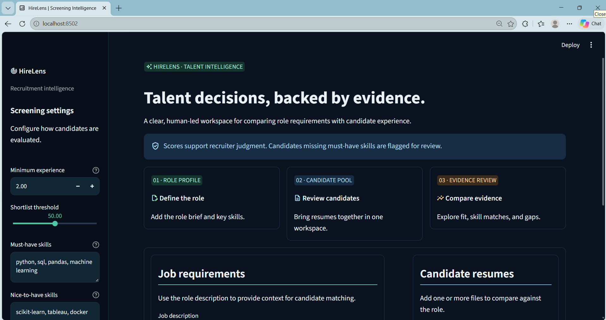

# HireLens — Automated Resume Screening Tool

> An explainable resume-screening prototype with a Streamlit recruiter workspace, configurable scoring, candidate evidence, a FastAPI service, and saved screening history.


This student-built portfolio project uses fictional sample resumes. It is a human-led decision-support demo, not an automated hiring decision maker.

---

## 👨‍💻 Author

**Adarsh Srivastav**<br>
Computer Science and Engineering (CSE) Student<br>
Python | Automation | Data Processing

---

## 📌 Project Overview

**HireLens** compares resumes with a job description and produces an explainable first-pass ranking. It extracts text from TXT, PDF, and DOCX files, measures text similarity, checks required skills, estimates experience, and shows the evidence behind each result.

The project includes a Streamlit workspace for recruiters, a command-line runner, and a FastAPI service. Screening runs from the dashboard can be saved to a local SQLite history database and exported as CSV or JSON.

> **Responsible-use note:** Scores support human review; they should not be treated as objective measures of candidate quality or used as the sole basis for hiring decisions.

---

## 🎯 Objectives

- Compare candidate resumes against a role description and explicit skill requirements.
- Make matched and missing must-have skills visible.
- Combine text similarity with configurable skill and experience signals.
- Give reviewers clear Shortlist, Review, or Reject labels with an inspectable score.
- Offer both an interactive dashboard and reusable CLI/API entry points.
- Keep sample data fictional and local run history out of version control.

---

## ✨ Key Features

- **Multi-format resume parsing:** TXT, PDF, and DOCX.
- **Hybrid relevance scoring:** TF-IDF/cosine similarity combined with skill and experience coverage.
- **Configurable weights:** Set similarity, must-have-skill, and experience weights.
- **Evidence review:** Inspect matched skills, missing must-have skills, and experience gaps.
- **Human-in-the-loop decisions:** Candidates who meet the score threshold but miss a must-have skill are flagged for review.
- **Optional skill signal:** Nice-to-have matches add a small bonus capped at five points.
- **Streamlit recruiter workspace:** Filter and search candidates, inspect evidence, and view score analytics.
- **FastAPI service:** Submit resumes through a REST endpoint and view interactive API documentation.
- **Screening history:** Store run settings and result snapshots in a local SQLite database.
- **Portable exports:** Download CSV and JSON reports.
- **CLI workflow:** Screen a folder of resumes and write a CSV report.

---

## 🏗️ System Architecture

```text
                         ┌─────────────────────────┐
                         │ Job description + skills│
                         └────────────┬────────────┘
                                      │
┌──────────────────────┐    ┌────────▼────────────┐    ┌────────────────────┐
│ Streamlit recruiter  │───▶│ Shared screening    │◀───│ FastAPI clients    │
│ workspace            │    │ pipeline            │     │ (REST / JSON)      │
└──────────────────────┘    └────────┬────────────┘    └────────────────────┘
                                      │
                  ┌───────────────────┼────────────────────┐
                  ▼                   ▼                    ▼
          TXT/PDF/DOCX         TF-IDF + rules       SQLite run history
          text extraction      scores + evidence    CSV / JSON exports
```

The Streamlit app calls the shared screening pipeline directly. The API is a separate integration entry point; the dashboard does not currently send requests to it.

---

## 🔄 Working Principle

1. Provide a job description, required skills, and optional skills.
2. Upload resumes in TXT, PDF, or DOCX format, or point the CLI at a resume folder.
3. Extract and normalize resume text.
4. Detect skills and estimate years of experience.
5. Calculate similarity, must-have coverage, and experience coverage.
6. Rank candidates and label each result Shortlist, Review, or Reject.
7. Review evidence, inspect analytics, save history, or export a report.

### Score Model

```text
Final score = similarity weight × TF-IDF similarity
            + skills weight × must-have coverage
            + experience weight × experience coverage
            + capped nice-to-have bonus
```

Default weights are 55% similarity, 35% must-have coverage, and 10% experience coverage. The three weights are normalized automatically, and the optional-skill bonus is capped at five points.

| Condition | Decision |
|---|---|
| Score meets threshold and no must-have skills are missing | Shortlist |
| Score meets threshold but one or more must-have skills are missing | Review |
| Score is below threshold | Reject |

The years-of-experience parser is a lightweight heuristic. Its estimate should be checked by a recruiter and is not a verified employment-history calculation.

---

## 📥 Supported Inputs

| Input | Details |
|---|---|
| Resume files | `.txt`, `.pdf`, and `.docx` |
| Job description | Text entered in the dashboard or loaded from `data/job_description.txt` by default in the CLI |
| Must-have skills | Comma-separated in the dashboard/API; command-line arguments in the CLI |
| Nice-to-have skills | Optional skill list used for a capped bonus |
| Screening settings | Minimum experience, shortlist threshold, and score weights |

The included `resumes/` folder contains four fictional TXT profiles for local demonstrations.

---

## 🧰 Software & Tools

- **Language:** Python 3.10+
- **Dashboard:** Streamlit
- **API:** FastAPI and Uvicorn
- **Data processing:** Pandas and NumPy
- **Text matching:** scikit-learn TF-IDF and cosine similarity
- **Resume extraction:** pdfplumber and python-docx
- **History:** SQLite
- **Testing:** pytest
- **Version control:** Git and GitHub

---

## 🖥️ Streamlit Dashboard

Run the app to open the HireLens recruiter workspace. It includes:

- **Screening inputs:** Configure a role description, skill requirements, experience minimum, threshold, and score weights; upload one or more resumes.
- **Ranking report:** Search and filter candidates, compare scores and decisions, and select a row to inspect evidence.
- **Score analytics:** Compare total fit scores and score components across candidates.
- **Run history:** Review saved screening results from earlier dashboard analyses.
- **Exports:** Download result reports in CSV or JSON format.

### Dashboard Preview



---

## 📸 Project Screenshots

The screenshots below use fictional sample data.

### Dashboard

| Screenshot | Demonstrates |
|---|---|
| [11_dashboard_overview.png](screenshots/11_dashboard_overview.png) | Branded recruiter workspace |
| [12_screening_inputs.png](screenshots/12_screening_inputs.png) | Job requirements and resume inputs |
| [03_streamlit_dashboard.png](screenshots/03_streamlit_dashboard.png) | Dashboard landing page |
| [13_candidate_rankings.png](screenshots/13_candidate_rankings.png) | Candidate scores and decisions |
| [14_candidate_evidence.png](screenshots/14_candidate_evidence.png) | Matched and missing requirements |
| [15_score_analytics.png](screenshots/15_score_analytics.png) | Score and component comparisons |
| [16_run_history.png](screenshots/16_run_history.png) | Saved screening run and results |

### Code and Verification

| Screenshot | Demonstrates |
|---|---|
| [01_project_structure.png](screenshots/01_project_structure.png) | Repository structure |
| [02_project_overview.png](screenshots/02_project_overview.png) | Project overview in the editor |
| [04_api_endpoints.png](screenshots/04_api_endpoints.png) | FastAPI route definitions |
| [05_screening_engine.png](screenshots/05_screening_engine.png) | Scoring and ranking pipeline |
| [06_skills_extraction.png](screenshots/06_skills_extraction.png) | Skill and experience extraction |
| [07_resume_processing.png](screenshots/07_resume_processing.png) | TXT, PDF, and DOCX processing |
| [08_cli_runner.png](screenshots/08_cli_runner.png) | CLI entry point |
| [09_run_history_store.png](screenshots/09_run_history_store.png) | SQLite audit-store logic |
| [10_test_results.png](screenshots/10_test_results.png) | Passing pytest run |

---

## 🛠️ Setup

### Prerequisites

- Python 3.10 or later
- Windows PowerShell, macOS Terminal, or a Linux shell

### Windows PowerShell

```powershell
git clone https://github.com/adarshsrivastav23905/Automated-Resume-Screening-Tool.git
Set-Location Automated-Resume-Screening-Tool
python -m venv .venv
.\.venv\Scripts\Activate.ps1
python -m pip install --upgrade pip
python -m pip install -r requirements.txt
```

### macOS / Linux

```bash
git clone https://github.com/adarshsrivastav23905/Automated-Resume-Screening-Tool.git
cd Automated-Resume-Screening-Tool
python3 -m venv .venv
source .venv/bin/activate
python -m pip install --upgrade pip
python -m pip install -r requirements.txt
```

Run commands from the repository root.

---

## ▶️ How to Run

### Streamlit Dashboard

```bash
streamlit run frontend/app.py
```

Open the local URL printed by Streamlit. The sample job description is preloaded; configure screening settings in the sidebar and upload resumes to start an analysis.

### Command-Line Screening

Run with the included defaults:

```bash
python -m backend.cli
```

The CLI reads `data/job_description.txt`, screens supported files in `resumes/`, and writes `outputs/ranking_report.csv`.

Customize the job, resume folder, required skills, and scoring options:

**Windows PowerShell**

```powershell
python -m backend.cli `
  --job data/job_description.txt `
  --resumes resumes `
  --must-have python sql pandas "machine learning" `
  --nice-to-have tableau scikit-learn `
  --minimum-years 2 `
  --threshold 50 `
  --similarity-weight 55 `
  --skill-weight 35 `
  --experience-weight 10 `
  --output outputs/ranking_report.csv
```

**macOS / Linux**

```bash
python -m backend.cli \
  --job data/job_description.txt \
  --resumes resumes \
  --must-have python sql pandas "machine learning" \
  --nice-to-have tableau scikit-learn \
  --minimum-years 2 \
  --threshold 50 \
  --similarity-weight 55 \
  --skill-weight 35 \
  --experience-weight 10 \
  --output outputs/ranking_report.csv
```

### FastAPI Service

```bash
uvicorn backend.api:app --reload
```

- Interactive API documentation: [http://localhost:8000/docs](http://localhost:8000/docs)
- Health check: [http://localhost:8000/health](http://localhost:8000/health)

---

## 🌐 API Overview

| Method | Route | Purpose |
|---|---|---|
| `GET` | `/health` | Check API availability |
| `POST` | `/screen` | Upload resumes and receive ranked screening results |

`POST /screen` accepts multipart form fields for `job_description`, comma-separated `must_have` and `nice_to_have` skills, `minimum_years`, `threshold`, and one or more resume files. Supported file types are TXT, PDF, and DOCX.

Example request:

```bash
curl -X POST http://localhost:8000/screen \
  -F "job_description=Data analyst with Python and SQL" \
  -F "must_have=python,sql,pandas" \
  -F "nice_to_have=tableau" \
  -F "minimum_years=2" \
  -F "threshold=50" \
  -F "files=@resumes/Aarav_Sharma.txt"
```

The API processes uploaded files in a temporary directory and returns results for the request; it does not save uploaded resume files. Run-history persistence is provided by the Streamlit workflow's SQLite audit store.

---

## 🧪 Testing

Run the tests from the project root:

```bash
python -m pytest -q
```

The tests cover basic ranking behavior, custom weight handling, and nice-to-have skill matching.

**Latest local result:** `2 passed`.

---

## 📊 Sample Data and Outputs

The repository includes four fictional TXT resumes and a sample Data Analyst job description.

- `outputs/ranking_report.csv` contains candidate scores, decisions, skill gaps, and score components after a CLI run.
- The Streamlit workspace can export a CSV or JSON report.
- `outputs/screening_history.db` is created locally by dashboard screenings and is excluded from Git.

All sample profiles are fictional and for demonstration only. Use synthetic or consented resumes; do not commit real candidate information.

---

## 📁 Project Structure

```text
Automated-Resume-Screening-Tool/
├── backend/
│   ├── __init__.py
│   ├── api.py                  # FastAPI endpoints
│   ├── cli.py                  # Command-line runner
│   └── app/
│       ├── __init__.py
│       ├── audit_store.py      # SQLite run history
│       ├── screening.py        # Scoring and ranking pipeline
│       ├── skills.py           # Skill and experience extraction
│       └── text_processing.py  # Resume extraction and text cleaning
├── data/
│   └── job_description.txt
├── docs/
│   └── PROOF_CHECKLIST.md
├── frontend/
│   ├── __init__.py
│   └── app.py                  # Streamlit recruiter dashboard
├── outputs/                    # Generated CSV and local SQLite history
├── resumes/                    # Fictional sample resumes
├── screenshots/                # Project and validation screenshots
├── tests/
│   └── test_pipeline.py
├── .streamlit/
│   └── config.toml
├── .gitignore
├── README.md
└── requirements.txt
```

---

## 🔁 Implementation Workflow

```text
Job Description + Screening Settings
                  │
                  ▼
          Resume File Ingestion
                  │
                  ▼
         Text Extraction and Cleanup
                  │
                  ▼
       Skills and Experience Signals
                  │
                  ▼
       Similarity + Weighted Scoring
                  │
          ┌───────┴────────┐
          ▼                ▼
  Ranked Evidence     Saved Run History
          │                │
          └───────┬────────┘
                  ▼
       Dashboard / API / CSV / JSON
```

---

## 📈 Results

The project demonstrates an end-to-end screening workflow:

- Extracts text from common resume formats.
- Produces a ranked result for each candidate.
- Surfaces skill matches, must-have gaps, and score components.
- Lets reviewers filter, search, and inspect results.
- Saves dashboard run settings and result snapshots locally.
- Provides CLI/API workflows and CSV/JSON exports.

---

## 🌐 Applications

The prototype can be used to explore or demonstrate:

- Resume-to-role comparison.
- First-pass candidate ranking for human review.
- Skill-gap visibility for recruiter workflows.
- REST API integration concepts for applicant-tracking systems.
- Explainable scoring and evidence review.

It is not a production hiring system and should not be used to make unsupervised employment decisions.

---

## ✅ Advantages

- Combines textual relevance with explicit skill and experience signals.
- Makes missing requirements visible instead of hiding them in a single score.
- Keeps scoring weights configurable and normalized.
- Includes dashboard, CLI, and API entry points.
- Uses local, fictional sample data and keeps the SQLite database out of Git.
- Provides a compact pytest suite and exportable reports.

---

## ⚠️ Limitations and Responsible Use

- TF-IDF reflects textual overlap, not a candidate's overall ability or potential.
- Resume layouts vary; text extraction can be incomplete or fail.
- Experience extraction is heuristic and must be verified by a qualified reviewer.
- The API is an unauthenticated development demo with no upload-size limits. Do not expose it publicly as-is.
- The local SQLite store is for a single-user demonstration, not concurrent multi-instance production.
- Run history can contain job descriptions and result snapshots; review and remove local data as appropriate.
- Do not use protected attributes such as age, race, religion, caste, or gender for screening.
- Use synthetic or consented resumes only, and keep a qualified human responsible for decisions.

---

## 🚀 Future Scope

- Improve structured experience extraction from employment date ranges.
- Add tests for PDF/DOCX extraction and FastAPI endpoint behavior.
- Add configurable skill dictionaries and candidate profile fields.
- Add authentication, authorization, upload limits, and data-retention controls.
- Add database migrations and managed persistence for multi-user use.
- Evaluate scoring with a consented, human-reviewed dataset.
- Add background processing and monitoring for larger resume batches.

---

## 🎓 Skills Demonstrated

### Python and Data Processing

- Python package structure and command-line interfaces.
- Resume parsing and text normalization.
- CSV/JSON data handling and local SQLite persistence.

### Search and Scoring

- TF-IDF vectorization and cosine similarity.
- Rule-based skill matching and experience signals.
- Configurable weighted scoring and result explanations.

### Application Development

- Streamlit dashboard development.
- FastAPI route and multipart upload handling.
- pytest-based testing, Git, and GitHub workflows.

---

## 💼 Industry Relevance

The project models an early-stage talent-screening workflow:

```text
Role Requirements
       ↓
Resume Ingestion
       ↓
Similarity and Skill Evidence
       ↓
Human Review
       ↓
Reports and Run History
```

Production use would require stronger privacy controls, authentication, secure upload handling, retention/deletion workflows, monitoring, and evaluation for fairness and reliability.

---

## 📚 Documentation

- [Project proof checklist](docs/PROOF_CHECKLIST.md)
- [Requirements](requirements.txt)

---

## 🔬 Project Status

### ✅ Functional Educational Prototype

The repository includes a Streamlit dashboard, CLI, FastAPI service, local screening history, CSV/JSON exports, fictional sample data, and a passing pytest suite.

---

## ⭐ Conclusion

**HireLens** demonstrates how resume text, explicit job requirements, and configurable scoring can be brought together in an inspectable screening workflow. Its evidence-first interface is designed to support recruiter judgment, not replace it.

---

## ⭐ Project Highlights

```text
Python 3.10+
TXT / PDF / DOCX Resume Parsing
TF-IDF + Skill + Experience Signals
Configurable Weighted Scores
Streamlit Dashboard + FastAPI + CLI
Candidate Evidence and Analytics
SQLite Run History
CSV / JSON Exports
pytest Test Suite
```

**Project status: ✅ Functional educational prototype | 🧑‍💼 Human-led review | 📊 Dashboard included**

## License

No license has been selected for this repository. Add a `LICENSE` file before permitting reuse or redistribution.
